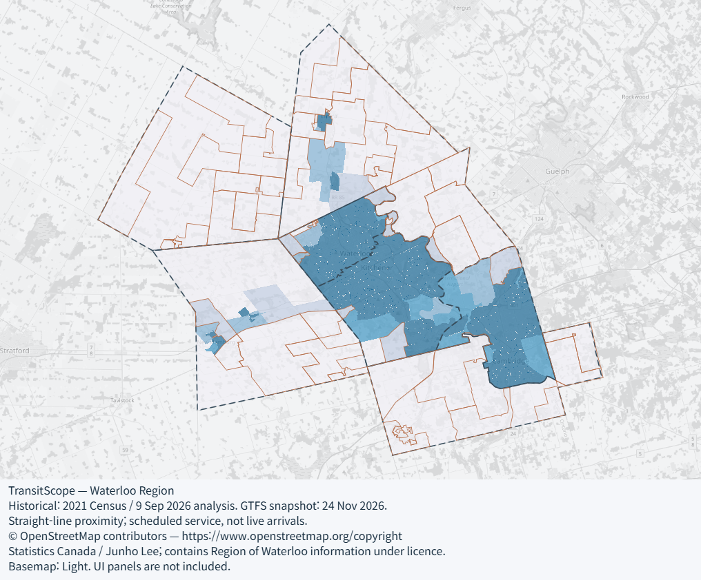

# TransitScope — Waterloo Region Transit Accessibility

An interactive Web GIS for exploring historical population proximity to public transit and a separately dated GRT network snapshot. TransitScope extends [the original Python spatial analysis](https://github.com/JunhoLee-Geo/Waterloo-transit-accessibility) into an accessible JavaScript mapping application without replacing its analytical results.

**Deployment status:** GitHub Pages publication is being verified. Intended destination: `https://junholee-geo.github.io/transitscope-waterloo/`.


*Actual map exported by the application; this image excludes dashboard controls. Browser UI evidence and capture limitations are documented in the outreach package.*

## Purpose and study area

Explore transit proximity across Cambridge, Kitchener, Waterloo, North Dumfries, Wellesley, Wilmot and Woolwich. The project connects reproducible spatial analysis with a static browser interface for a University of Waterloo GDS187 Geomatics Outreach Report and GIS development portfolio. It is not a live trip planner or an official agency application.

## Features

- Historical DA choropleth, priority areas and municipality-specific statistics.
- Population-weighted municipal rankings for400m/800m access, residents beyond800m and priority DA count.
- Overview/Layers/Compare tabs, opacity and visibility controls, dynamic legends and responsive analytics drawer.
- Local search for municipality, DAUID, stop name/ID and route; camera movement, highlighting and contextual details.
- Separate24November2026scheduled stop frequency, route shapes and dissolved proximity buffers; network layers off by default.
- Light/Standard OSM streets and a street-free dark analysis background; unified map tools and graceful fullscreen fallback.
- Selected-feature and comparison CSV, plus attributed map PNG exports.
- Methodology, source and limitations views; source manifests and automated tests.

## Verified historical findings

Values below are computed from saved DA estimates and reconciled against the original GeoPackages, not hardcoded application targets.

| Measure | Result |
|---|---:|
|2021 study population|587,165|
|Dissemination Areas|766|
|Estimated residents within400m|437,870|
|Estimated residents within800m|506,721|
|Estimated residents beyond800m|80,444|
|Priority underserved DAs|52|

Population estimates are rounded here; exports retain precision. Historical analysis date is9September2026. The original GTFS archive remains unavailable, and historical high-frequency population coverage is not validated. The separate GTFS release uses24November2026,07:00–19:00,America/Toronto; it does not update these population estimates.

## Technology and architecture

HTML5/CSS3, ES modules, MapLibre GL JS6.19.0, Vite7.3.8, GeoJSON, Python/GeoPandas and GitHub Pages. No backend, UI framework, geocoding service or API key is required. WebGL and internet connectivity for street tiles are needed.

```text
src/
  main.js          map lifecycle, historical layers and selection
  dashboard.js     tabs, scope, dialogs and statistical components
  statistics.js    validated population-weighted aggregation
  data.js          choropleth classes and historical display fields
  transit.js       separate GTFS layers and interactions
  search.js        local feature index and keyboard suggestions
  map-tools.js     basemap, camera and PNG handling
  export.js        CSV encoding and downloads
  style.css        design system and responsive layouts
public/data/       historical GeoJSON, summaries and source manifest
  transit/         five network GeoJSON files and GTFS manifest
scripts/           preparation, download and release validation
 tests/            JavaScript and Python regression tests
 docs/             audits, learning log and validation records
  outreach-report/ academic evidence package
.github/workflows/ reproducible Pages build/deployment
```

## Sources and methodology

Historical Census/DA results come from Statistics Canada2021Census and the original analysis. Current municipal outlines and GTFS are from the Region of Waterloo/GRT, downloaded24November2026. [Data sources](docs/outreach-report/data-sources.md), [licensing](LICENSE.md), [historical manifest](public/data/manifest.json) and [network manifest](public/data/transit/manifest.json) record provenance.

Buffers are straight-line proximity, not walking distances. Covered population is area-weighted within DAs, assuming uniform density. Municipality rates divide summed covered population by summed population; percentages are not averaged across DAs. Priority selects less than50% within800m and at least500estimated residents beyond800m. Distances use EPSG:26917; web GeoJSON uses WGS84 longitude/latitude (EPSG:4326/RFC7946). Scheduled nonterminal, unrestricted-pickup departures are filtered by service date and window; average frequency does not measure headway consistency or reliability.

## Local installation

Use Node24 (Node22.12+ is supported) and npm:

```sh
npm ci
npm run dev
```

Open the exact Local URL printed by Vite. Python is not needed to view the included data.

```sh
npm test
npm run check
npm run build
npm run preview
```

The lockfile is committed. `dist/`, dependencies, raw archives, environments and local secrets are ignored.

## Data processing and validation

Create a Python3.12environment and install `requirements-data.txt`. Clone the original analysis separately, then run:

```sh
python scripts/prepare_data.py --source-dir /path/to/original-analysis
python scripts/prepare_gtfs.py --service-date 2026-11-24
python scripts/validate_release.py --source-dir /path/to/original-analysis --archive-dir data/raw/gtfs-phase3
python -m unittest discover -s tests -p "test_*.py"
```

GTFS preparation requires the recorded archives and sources.json. See [GTFS workflow](scripts/GTFS.md) for acquisition and snapshot limitations. Mutable official URLs cannot guarantee recovery of the exact archived feed. The release validator fails explicitly if original inputs are absent. [Final spatial results](docs/release-data-validation.md) include numerical tolerances and attribute/geometry checks.

## Deployment

The workflow uses Node24, `npm ci`, tests, syntax checks and a Vite build, then publishes only `dist/` using GitHub Pages Actions. `GITHUB_ACTIONS` sets the production base to `/transitscope-waterloo/`; local development retains a relative base. Data uses Vite'sBASE_URL. Navigation uses dialogs rather than server routes.

For a new deployment: create the separate public repository, push main, set Settings→Pages→Source to GitHub Actions, run the workflow, then verify the public application and its data URLs. See [deployment and QA record](docs/outreach-report/final-qa-report.md). Do not infer a successful deployment from the intended URL alone.

## Limitations and future work

Historical GTFS recovery; walking-network/service-reliability analysis; source boundary version matching; broader screen-reader/cross-browser testing; measured low-end-device performance; and report-ready UI screenshot capture remain opportunities. Current routes and buffers stay regional when municipality filters are applied to DAs/stops. Stops appear at zoom11+ rather than clustering. PNG excludes HTML panels and refuses incomplete map loads. Fullscreen can be denied by embedded browsers. OSM tile services are external and best-effort; evaluate a production provider as traffic grows. Vite's MapLibre bundle-size warning remains.

## Academic record and licensing

The [outreach report package](docs/outreach-report/project-summary.md) and [learning log](docs/learning-log.md) separate automated implementation/testing from personal activities still to perform. No student reflection, tutorial completion or independent coding experience is invented.

Adapted from Statistics Canada,2021Census. This does not constitute an endorsement by Statistics Canada of this product. Contains information provided by the Regional Municipality of Waterloo under licence. Basemap ©OpenStreetMap contributors. See [LICENSE.md](LICENSE.md) for separate software/data rights; no blanket software licence is applied to third-party data.
